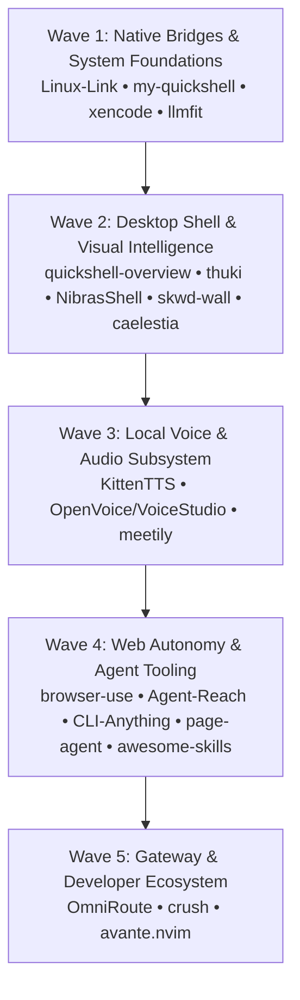

# AGENTS.md — Development & Operating Guide for AI Agents

> **Authoritative agent guideline for Project FRIDAY (Friday OS Cognitive Operating System).**
> All autonomous agents, subagents, and contributors modifying this codebase must adhere to the rules, architecture contracts, and roadmaps documented here.

---

## 1. Project Mission & Identity

**FRIDAY OS** is an Arch Linux-based **Cognitive Operating System** designed from first principles. It fuses a Wayland dynamic tiling substrate (Hyprland + Quickshell + SDDM) with a native Rust cognitive daemon (`friday-linux-daemon`), an intent-driven agent kernel, local speech/vision/audio intelligence, and universal desktop automation.

- **Primary Repository Workspace**: `/home/sreevarshan/projects/project-friday`
- **Substrate Layers**: Omarchy (Wayland, Hyprland, Quickshell, SDDM) + Friday Cognitive Subsystems (Planner, Actions, Memory, Intelligence, Sensors).
- **Core CLI Interfaces**:
  - `friday` — Primary user and system CLI (`friday status`, `friday goal "<objective>"`, `friday theme`, etc.)
  - `friday-ctl` — Desktop IPC and HUD controller (toggles floating assistant HUD, quick actions, audio capture)
  - `friday-linux-daemon` — Continuous background cognitive daemon
  - `friday-skill-forge` — Skill compiler, validator, and packager

---

## 2. Core Agent Principles

1. **Verify Before Declaring Done**:
   Never claim a feature works without empirical evidence. For desktop/ISO changes, run the QEMU test VM (`iso/friday/test/run-qemu.sh`) and capture visual screenshots via `iso/friday/test/vm-control.py screenshot`. For Rust crates, run `cargo test -p <crate>`.
2. **Atomic, Coherent Changes**:
   Implement features incrementally. Do not batch unrelated changes into single edits or commits. Follow conventional commit messages (`feat(...)`, `fix(...)`, `docs(...)`, `refactor(...)`).
3. **Preserve Architectural Discipline**:
   - The Core Agent Kernel stays abstract and ignorant of plugin internals.
   - Subsystems communicate strictly via the Event Bus and IPC contracts (defined in `specs/`).
   - Changes to the live ISO filesystem must be staged in `iso/friday/airootfs/` and declared in `profiledef.sh` and `packages.x86_64`.
4. **No Destructive Operations**:
   Preserve existing user configurations and code integrity. Do not wipe work directories without verifying cache reuse.

---

## 3. The 20-Capability Strategic Roadmap (1-by-1 Rollout)

Project FRIDAY incorporates 20 high-value capabilities curated from starred repositories into a unified 5-wave implementation roadmap:

### Wave 1 — Native Bridges & Hardware Adaptation
- **`sreevarshan-xenoz/Linux-Link`**: Remote desktop and phone pairing over Tailscale (Wayland streaming, clipboard sync, remote input).
- **`sreevarshan-xenoz/my-quickshell-config`**: Integration of the user's custom Quickshell QML shell and UPGRADE_ROADMAP modules.
- **`sreevarshan-xenoz/xencode`**: Local offline-first agentic coding companion integrated into the terminal/daemon.
- **`AlexsJones/llmfit`**: First-boot hardware profiler that evaluates CPU/GPU/VRAM to auto-configure optimal Ollama models.

### Wave 2 — Wayland Desktop Shell & Visual Intelligence
- **`Shanu-Kumawat/quickshell-overview`**: Interactive drag-and-drop workspace overview for Hyprland.
- **`quiet-node/thuki`**: Lightweight context-aware floating AI companion widget for desktop tasks.
- **`AhmedSaadi0/NibrasShell`**: Native AI prompt and response UI widgets in Quickshell.
- **`liixini/skwd-wall`**: Aesthetics-first wallpaper and video background selector in Rust.
- **`caelestia-dots/shell`**: Alternative morphing shell option in the Friday installer.

### Wave 3 — Voice, Speech & Iron Man Persona
- **`KittenML/KittenTTS`**: Ultra-fast on-device TTS under 25MB for sub-second spoken replies.
- **`myshell-ai/OpenVoice` / `debpalash/VoiceStudio`**: Friday / Jarvis voice cloning and expressive speech profiles.
- **`Zackriya-Solutions/meetily`**: 100% local meeting notes, live Whisper transcription, and audio processing.

### Wave 4 — Autonomous Browser & Universal System Control
- **`browser-use/browser-use`**: Full browser automation agent for `friday goal` web tasks.
- **`Panniantong/Agent-Reach`**: Zero-cost internet search and article scraping for agent awareness.
- **`HKUDS/CLI-Anything`**: Universal translation layer making any installed Linux CLI agent-native.
- **`alibaba/page-agent`**: Natural language DOM operator for GUI web pages.
- **`sickn33/agentic-awesome-skills`**: Pre-built skill catalog integration into `friday-skill-forge`.

### Wave 5 — Gateway & Developer Power Tools
- **`diegosouzapw/OmniRoute`**: Local-first multi-model AI gateway with token compression.
- **`charmbracelet/crush`**: Beautiful terminal agent for interactive coding.
- **`avante-corp/avante.nvim`**: Cursor AI-like Neovim configuration pre-bundled in default skeleton.

---

## 4. Testing & Verification Infrastructure

- **QEMU Debug VM Control**:
  - Script: `iso/friday/test/vm-control.py`
  - Status check: `python3 iso/friday/test/vm-control.py status`
  - Run command in VM: `python3 iso/friday/test/vm-control.py exec "<command>"`
  - Send key to VM: `python3 iso/friday/test/vm-control.py monitor "sendkey <key>"`
  - Screenshot live VM: `python3 iso/friday/test/vm-control.py screenshot --output <path.png>`
- **ISO Rebuild**:
  - Fast rebuild: `CLEAN_WORK=false bash iso/friday/build-iso.sh`
  - Output directory: `/tmp/friday-iso-out/friday-<version>-x86_64.iso`
  - Public symlink: `iso/out/friday-latest.iso`

---

## 5. Implementation Protocol (Step-by-Step Rule)

When instructed to implement items from the roadmap:
1. **Focus on exactly ONE item at a time**.
2. Document the implementation contract in `docs/` or `specs/`.
3. Implement the crate/service/script with strict test coverage.
4. Integrate the deliverable into `iso/friday/airootfs` or the cargo workspace.
5. Verify in the live test environment and document the result before advancing to the next item.
