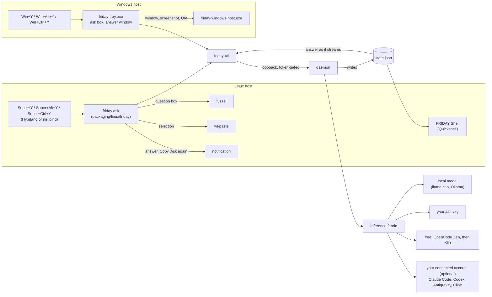
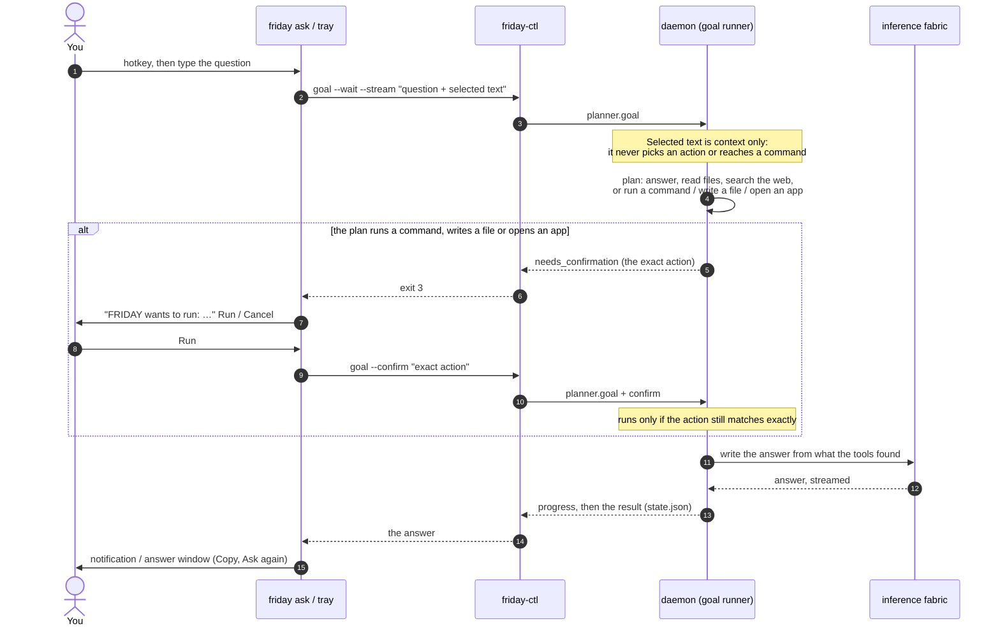
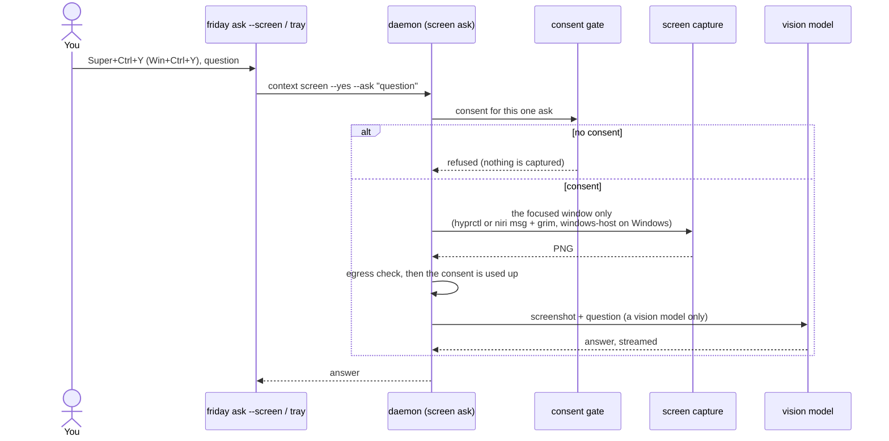
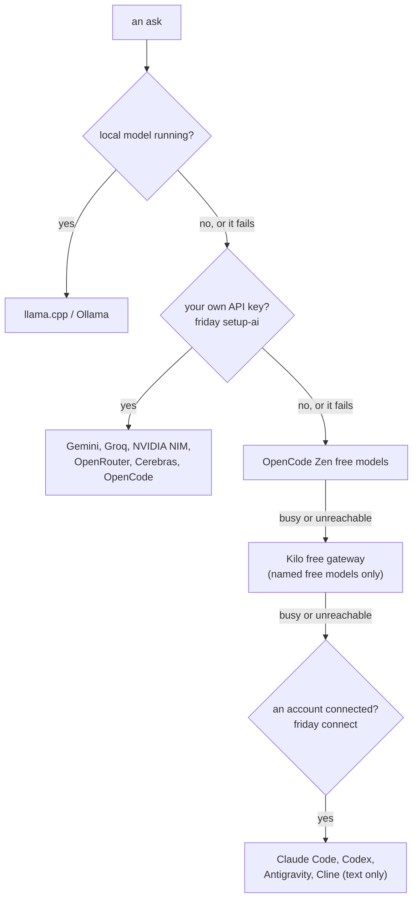
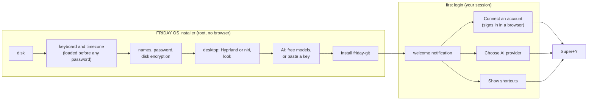

# FRIDAY

A standalone desktop assistant for Windows and Linux: one Rust core, a thin host per platform, installable on an existing machine. FRIDAY OS (the Arch ISO) is the reference Linux setup, not the only way in.

**The core use case:** press a key, ask about what is on screen or selected, get a useful answer or action, reliably, on both platforms.

System integration, not kernel code: UI Automation, ETW and Win32 on Windows; AT-SPI, portals, compositor IPC, eBPF, D-Bus and systemd on Linux. No kernel drivers or modules unless nothing else can do it.

| Part | Where |
|---|---|
| Core and daemon | Rust workspace (`core`, `planner`, `services/*`). `friday-linux-daemon` (`services/mobile`; shipped as `friday-daemon.exe` on Windows) runs every ask and publishes `state.json`. |
| Linux | `friday` CLI (`packaging/linux/friday`), FRIDAY Shell (`packaging/linux/shell`, Quickshell), Hyprland and niri key bindings, all in the `friday-git` Arch package (`packaging/arch`). |
| Windows | `friday-tray.exe` (`windows-tray/`, .NET 8): per-user tray app with the hotkeys, the ask box and the answer window; supervises the daemon and `windows-host/` (C#: UI Automation, Win32, screenshots). Per-user MSI in `installer/windows/`. |
| FRIDAY OS | `iso/friday/`: the reference Arch ISO. FRIDAY Shell on Omarchy's pinned Hyprland configuration, or on niri. |

## How it fits together



Both hosts talk to the same daemon through `friday-ctl`: it sends the ask over a loopback, token-gated connection and follows the answer in `state.json` (`~/.local/state/friday`, `%LOCALAPPDATA%\friday`), which FRIDAY Shell also reads for its status orb and drawer. The contracts stay narrow: the IPC and events in `specs/ipc.md` and `specs/events.md`, and `state.json`.

## What happens when you ask



- **Nothing runs unless you asked, and confirmed.** A command, a file write or an app launch shows the exact action first; the confirmation is good for that action and that ask only. Gathering evidence for an answer can only read.
- **Clear failures.** No network, a provider's rate limit, a timeout or a stopped daemon each come back as one plain sentence. A command that hangs is stopped after 60 s.
- **Upgrades.** After `pacman -Syu` replaces the daemon, it restarts itself the next time it is idle.

## Screen asks



A screenshot is taken only for a screen ask, of the window you were looking at (the whole screen only when there is no focused window), and only sent to a model that can see images. The daemon's background observation of the focused window reads its title and size, not its pixels (opt in with `FRIDAY_OBSERVE_PIXELS=1`). A screen ask runs beside the daemon's other work and can be cancelled.

## Which AI answers



- **Out of the box:** no key, no sign-in. OpenCode Zen's free models, then Kilo's free gateway as the fallback; never Kilo's unnamed "stealth" models or its auto-router.
- **Your own key** (`friday setup-ai`, or the tray's AI provider window) comes first. `--keep-others` keeps your other keys as fallbacks; `--only` keeps just the new one.
- **Your own account** (`friday connect claude|codex|agy|cline` on Linux, **Connect an account** in the tray on Windows) is optional, and by default only a fallback when the free models can't answer: it starts the tool's app for each answer (seconds slower) and counts against your plan. `friday connect --prefer <name>` (or `FRIDAY_PREFER_ACCOUNTS=1`) uses it before the free models instead, still after your own key. It answers through that tool's own app and sign-in. FRIDAY never sees the credentials, and runs the tool with no tools of its own, in an empty folder. These are text only: a screenshot never goes to them. On Windows only a native `.exe` can be used (Claude Code, Antigravity, Codex's native build); Cline is Linux-only for now.
- **Screen asks** go only to models that can see images: your vision provider, or the free ones.
- **Timeouts:** 5 s to connect, 15 s per text attempt, 45 s for a screenshot, 90 s for a connected account (it starts a whole app).
- **Weekly model check:** Free models rotate and disappear upstream without notice. A scheduled CI workflow checks the built-in free models weekly against keyless endpoints and reports catalog drift (`cargo test -p friday-intelligence -- --ignored model_check`).

> **Free models and your data.** Free models may keep what you send them (questions, selected text, screenshots) and may use it for training. For anything private, use your own key or account.

## From install to the first answer



Signing in to Claude Code, Codex, Antigravity or Cline needs a browser and your own session, so it happens at the first login (or any time with `friday connect`), not in the installer. The installer refuses a legacy-BIOS boot before it touches the disk (FRIDAY OS uses systemd-boot, which needs UEFI).

## Hotkeys

| | Linux (Hyprland, niri) | Windows (fallback if taken) |
|---|---|---|
| Ask | `Super+Y` (`friday ask`) | `Win+Y` (`Ctrl+Alt+Y`) |
| Ask about the selection | `Super+Alt+Y` (`friday ask --selection`) | `Win+Alt+Y` (`Ctrl+Alt+Shift+Y`) |
| Ask about the screen | `Super+Ctrl+Y` (`friday ask --screen`) | `Win+Ctrl+Y` (`Ctrl+Alt+Shift+S`) |

The bindings ship in `packaging/linux/hyprland/friday.lua` and `packaging/linux/niri/friday.kdl`; on Windows the tray registers them, retrying the Win+ key briefly before falling back.

## Installation

### Arch Linux

```bash
cd packaging/arch && makepkg -si
systemctl --user enable --now friday-linux-daemon
friday doctor
```

The package installs the daemon, `friday-ctl`, the `friday` CLI, the systemd user service, the Hyprland and niri bindings and FRIDAY Shell. Optional: `friday setup-ai` for a key, `friday connect` for an account.

### Windows

```powershell
msiexec /i FRIDAY-<version>-x64.msi        # add /qn for a silent install
```

Per-user, no administrator rights: installs to `%LOCALAPPDATA%\Programs\FRIDAY`, starts the tray at login, adds the tools to the user `PATH` and the Start menu, and runs entirely in your desktop session (it needs the desktop for UI Automation, screenshots and hotkeys). Upgrades and uninstalls close the tray, daemon and host first.

### FRIDAY OS

```bash
CLEAN_WORK=true bash iso/friday/build-iso.sh
```

Builds `friday-git` and an Arch ISO whose installer sets up the whole desktop. Prebuilt ISOs are on the [releases page](https://github.com/sreevarshan-xenoz/project-friday/releases).

### Updates

Each release publishes `friday-git` to a signed pacman repo, so `sudo pacman -Syu` keeps FRIDAY current. FRIDAY OS installs from v0.2.2 on have it set up already. On Arch, or on an earlier FRIDAY OS install, trust FRIDAY's release key once (fingerprint `8CC5 1D30 6AAE 9874 EB05 6A81 6954 E96E 5CA1 63C2`, also in [`packaging/arch/friday-signing-key.asc`](packaging/arch/friday-signing-key.asc)):

```bash
curl -fsSLo /tmp/friday-signing-key.asc https://raw.githubusercontent.com/sreevarshan-xenoz/project-friday/dev/packaging/arch/friday-signing-key.asc
sudo pacman-key --add /tmp/friday-signing-key.asc
sudo pacman-key --lsign-key 8CC51D306AAE9874EB056A816954E96E5CA163C2
```

then add this to `/etc/pacman.conf`:

```ini
[friday]
SigLevel = Required DatabaseRequired
Server = https://github.com/sreevarshan-xenoz/project-friday/releases/download/pacman
```

pacman refuses any package or database that key didn't sign. On Windows, install the newer MSI over the old one.

## Commands

| Command | What it does |
|---|---|
| `friday ask [--selection\|--screen] [text]` | Ask (what the hotkeys run) |
| `friday setup-ai [--keep-others\|--only] [provider]` | Use your own API key |
| `friday connect [--prefer] [claude\|codex\|agy\|cline]` / `friday disconnect <name>` | Use an account you already have (a fallback unless `--prefer`) |
| `friday answers [--last]` | Past answers (kept private, in `~/.local/state/friday`) |
| `friday sent [N]` | What left this machine for AI providers (egress log) |
| `friday shell style\|palette` | FRIDAY Shell's look, matched on Hyprland or niri |
| `friday doctor` | Why isn't FRIDAY working? |
| `friday report` | A redacted bug report to read, then share |
| `friday face setup` | Face unlock for the lock screen (Gaze, on this computer; `status`, `remove`) |

## Plan

The phases in [AGENTS.md](AGENTS.md), top to bottom; a later phase doesn't start while an earlier one has known failures:

1. First hour works (a VM install and a clean Windows install; a real-hardware pass is next)
2. Automate it (CI: desktop and installer checks, the Arch package, the MSI, asks and hotkeys end to end on both platforms)
3. Make the core use case excellent (context, answer quality, actions, latency, clear failures)
4. Standalone packages (`friday-git`, the MSI, `vX.Y.Z` releases gated on CI)
5. Deeper integration (system interfaces, each behind consent)
6. The [ecosystem backlog](docs/roadmap/ecosystem-backlog.md)

## Repository layout

```
core/            friday-core: event bus, memory, protocol, runtime
planner/         planning engines
services/        the daemon (services/mobile), inference fabric (intelligence),
                 goal execution, action runtime, context collector, sensors, …
packaging/       arch/ (friday-git PKGBUILD) and linux/ (friday CLI, service,
                 Hyprland and niri bindings, FRIDAY Shell)
installer/       windows/ (WiX MSI, build script, winget manifests)
windows-tray/    the Windows tray (.NET 8) and its tests
windows-host/    the Windows desktop host (C#)
friday-os/       FRIDAY OS plugins for Omarchy's shell
iso/friday/      the FRIDAY OS ISO profile, installer and its checks
tests/e2e/       asks and hotkeys end to end (real daemon, fake model)
specs/, docs/    specifications and documentation
```

## Build and test

| Target | Command |
|---|---|
| Rust | `cargo test -p <crate>` (CI also runs fmt and clippy `-D warnings`) |
| An ask end to end | `bash tests/e2e/ask.sh` |
| The hotkeys end to end | `bash tests/e2e/hotkeys.sh`; Windows: `pwsh tests/e2e/hotkeys.ps1` |
| Desktop, installer and CLI checks | `bash iso/friday/test/run-checks.sh` |
| Built-in free AI models | `cargo test -p friday-intelligence -- --ignored model_check` |
| Windows tray | `dotnet test windows-tray/FridayTray.Tests` |
| Windows MSI | `pwsh installer/windows/build.ps1` |
| Arch package | `cd packaging/arch && makepkg -si` |

More in the Commands table of [AGENTS.md](AGENTS.md), including the test VM.

## Documentation

- [AGENTS.md](AGENTS.md): guide for contributors and agents: rules, plan, commands
- [docs/HANDOFF-2026-11-04.md](docs/HANDOFF-2026-11-04.md): the Linux first-hour checklist
- [docs/Architecture.md](docs/Architecture.md), [docs/Security.md](docs/Security.md)
- [specs/README.md](specs/README.md), [specs/ipc.md](specs/ipc.md), [specs/events.md](specs/events.md)
- [installer/windows/README.md](installer/windows/README.md), [tests/README.md](tests/README.md)

## License

Dual-licensed under the MIT License ([LICENSE-MIT](LICENSE-MIT)) or the Apache License, Version 2.0 ([LICENSE-APACHE](LICENSE-APACHE)).
