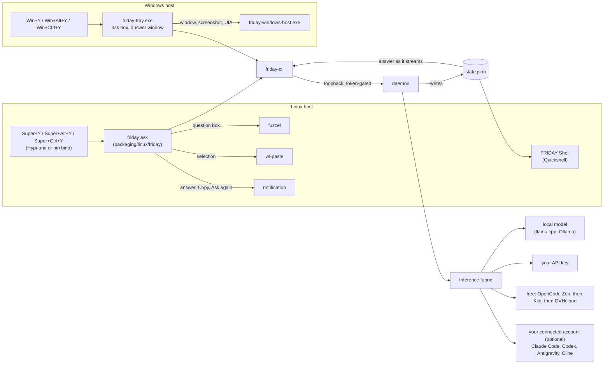
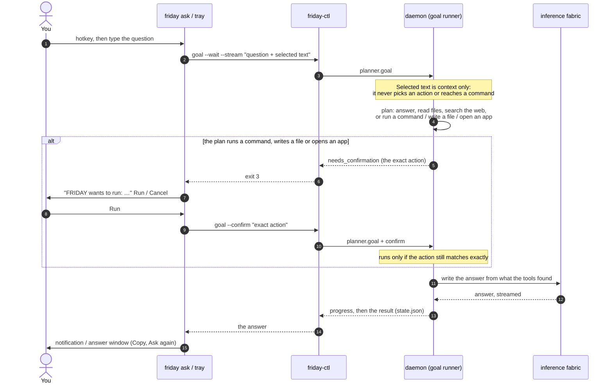
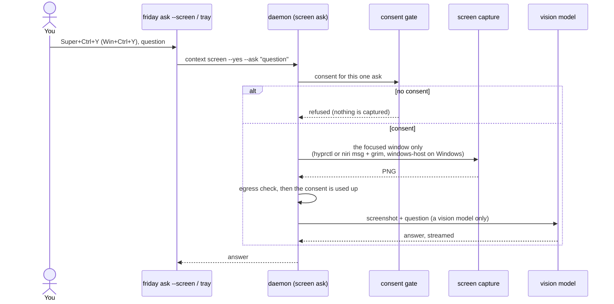
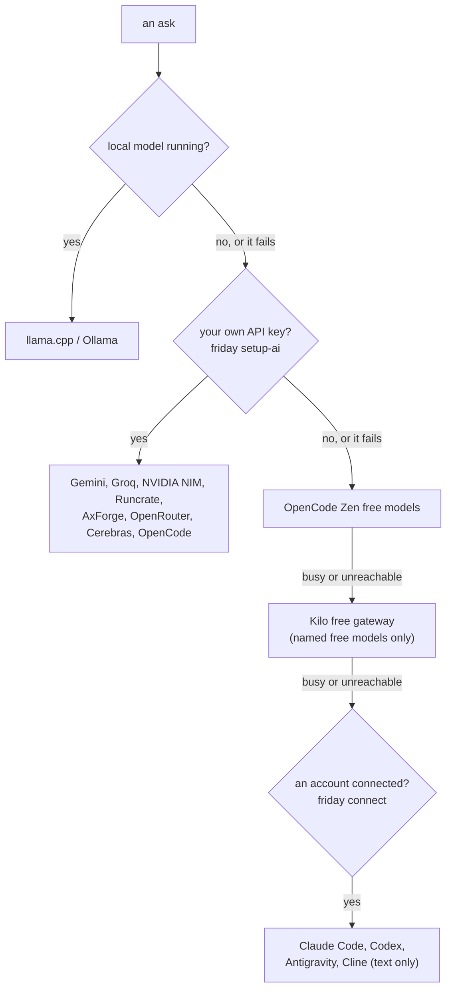
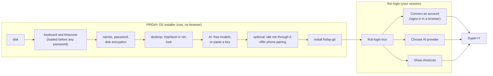

# FRIDAY

A standalone desktop assistant for Windows and Linux: one Rust core, a thin host per platform, installable on an existing machine. FRIDAY OS (the Arch ISO) is the reference Linux setup, not the only way in.

**The core use case:** press a key, ask about what is on screen or selected, get a useful answer or action, reliably, on both platforms.

System integration, not kernel code: UI Automation, ETW and Win32 on Windows; AT-SPI, portals, compositor IPC, eBPF, D-Bus and systemd on Linux. No kernel drivers or modules unless nothing else can do it.

| Part | Where |
|---|---|
| Core and daemon | Rust workspace (`core`, `planner`, `services/*`). `friday-linux-daemon` (`services/mobile`; shipped as `friday-daemon.exe` on Windows) runs every ask and publishes `state.json`. |
| Linux | `friday` CLI (`packaging/linux/friday`), FRIDAY Shell (`packaging/linux/shell`, Quickshell), Hyprland and niri key bindings, all in the `friday-git` Arch package (`packaging/arch`). |
| Windows | `friday-tray.exe` (`windows-tray/`, .NET 8): per-user tray app with the hotkeys, the ask box and the answer window; supervises the daemon and `windows-host/` (C#: UI Automation, Win32, screenshots). Per-user MSI in `installer/windows/`. |
| FRIDAY OS | `iso/friday/`: the reference Arch ISO. FRIDAY Shell on Omarchy's pinned Hyprland configuration, or on niri. |

New here? [Using FRIDAY](docs/USING.md) is the short tour: the keys, the answer pill and where your data goes.

**What you get**

- **Ask about your screen or selection**, with one-time consent for a screenshot; "what is on my screen" in words works too.
- **Answers out loud, made on your computer**: a CPU voice (tiny voca by default, 50 MB and starting at once, running inside FRIDAY; Kokoro, with Bella and seven more, is the expressive option, and the lighter Kitten and Supertonic voices are there too), no GPU, nothing sent anywhere to speak. FRIDAY can talk you through the install, too.
- **Control apps and windows** by name on both platforms (open, focus, volume, media, desktops); anything that deletes or sends asks first.
- **"How is my computer doing?"**: a read-only look at services, errors, disk, memory and battery, in plain words.
- **A settings app on each platform** for people who don't use a terminal ([the pages](docs/SETTINGS-PAGES.md)), and a first-login tour (a welcome window on Windows).
- **Private by default where it counts**: free models are the starting point and are labelled as such; your own key, an account you already have, or a local model are one click away; a log shows what left the machine.

## How it fits together



Both hosts talk to the same daemon through `friday-ctl`: it sends the ask over a loopback, token-gated connection and follows the answer in `state.json` (`~/.local/state/friday`, `%LOCALAPPDATA%\friday`), which FRIDAY Shell also reads for its status orb and drawer. The contracts stay narrow: the IPC and events in `specs/ipc.md` and `specs/events.md`, and `state.json`.

## What happens when you ask



- **Nothing runs unless you asked, and confirmed.** A command, a file write or an app launch shows the exact action first; the confirmation is good for that action and that ask only. Gathering evidence for an answer can only read.
- **Clear failures.** No network, a provider's rate limit, a timeout or a stopped daemon each come back as one plain sentence. A command that hangs is stopped after 60 s.
- **Upgrades.** After `pacman -Syu` replaces the daemon, it restarts itself the next time it is idle.

## Screen asks



A screenshot is taken only for a screen ask, of the window you were looking at (the whole screen only when there is no focused window), and only sent to a model that can see images. The daemon's background observation of the focused window reads its title and size, not its pixels (opt in with `FRIDAY_OBSERVE_PIXELS=1`). A screen ask runs beside the daemon's other work and can be cancelled.

## Which AI answers



- **Out of the box:** no key, no sign-in. OpenCode Zen's free models (also through OpenCode's own CLI when it's installed), then Kilo's free gateway, then OVHcloud's AI Endpoints (EU, no account) as fallbacks; never Kilo's unnamed "stealth" models or its auto-router.
- **A model on your computer** (the FRIDAY OS installer, or `friday setup-ai local`): FRIDAY checks the memory, GPU and disk, offers Light / Balanced / Most presets (and a GPU one with a discrete card), and says what each gets: no local AI under 2 GB, text only up to qwen3:4b, screenshots from gemma3:4b up. Ollama (Arch package) or llama.cpp (its official build, pinned and checksummed). Who answers first depends on the model (Auto): above 4B the local model does, if it answers at least 8 tokens a second here (timed at setup; `friday local-ai bench` measures again), and cloud covers what it can't; at 4B and below cloud answers first while online, so questions go to a cloud model, and the local model takes over offline or when cloud limits run out. `friday local-ai order local|cloud|auto` or FRIDAY Settings changes it; `friday private on` keeps everything on the computer.
- **Your own key** (`friday setup-ai`, or the tray's AI provider window) comes first. `--keep-others` keeps your other keys as fallbacks; `--only` keeps just the new one.
- **Your own account** (`friday connect claude|codex|agy|cline|hermes` on Linux, **Connect an account** in the tray on Windows) is optional, and by default only a fallback when the free models can't answer: it starts the tool's app for each answer (seconds slower) and counts against your plan. `friday connect --prefer <name>` (or `FRIDAY_PREFER_ACCOUNTS=1`) uses it before the free models instead, still after your own key. It answers through that tool's own app and sign-in. FRIDAY never sees the credentials, and runs the tool with no tools of its own, in an empty folder. These are text only: a screenshot never goes to them. Hermes Agent answers with whatever provider its own setup chose (Nous Portal's free tier needs a Nous sign-in and serves one rate-limited model); its one-shot mode approves tools by itself, so FRIDAY gives it a toolset with no tools. On Windows only a native `.exe` can be used (Claude Code, Antigravity, Codex's native build); Cline is Linux-only for now.
- **Screen asks** go only to models that can see images: your vision provider, or the free ones.
- **Timeouts:** 5 s to connect, 15 s per text attempt, 45 s for a screenshot, 90 s for a connected account (it starts a whole app).
- **Weekly model check:** Free models rotate and disappear upstream without notice. A scheduled CI workflow checks the built-in free models weekly against keyless endpoints and reports catalog drift (`cargo test -p friday-intelligence -- --ignored model_check`).

> **Free models and your data.** Free models may keep what you send them (questions, selected text, screenshots) and may use it for training. For anything private, use your own key or account.

## From install to the first answer



Signing in to Claude Code, Codex, Antigravity or Cline needs a browser and your own session, so it happens at the first login (or any time with `friday connect`), not in the installer. The installer refuses a legacy-BIOS boot before it touches the disk (FRIDAY OS uses systemd-boot, which needs UEFI).

## Hotkeys

| | Linux (Hyprland, niri) | Windows (fallback if taken) |
|---|---|---|
| Ask | `Super+Y` (`friday ask`) | `Win+Y` (`Ctrl+Alt+Y`) |
| Ask about the selection | `Super+Alt+Y` (`friday ask --selection`) | `Win+Alt+Y` (`Ctrl+Alt+Shift+Y`) |
| Paste the clipboard transformed | `Super+Alt+V` (`friday paste-as`) | not yet |
| Ask about the screen | `Super+Ctrl+Y` (`friday ask --screen`) | `Win+Ctrl+Y` (`Ctrl+Alt+Shift+S`) |
| Ask about an area you drag out | `friday ask --region` | tray menu, "Ask about an area…" |

`Super+Y` suggests what fits the app you're in, first in the ask box: "Summarize this page" in a browser or document viewer (it asks about the screen, so screen text or a screenshot is used only when you pick it), "Summarize this email" in a mail app, and "Explain the selected code" (or text) when something is highlighted.

In kitty (FRIDAY OS's terminal), `Super+Y` right after a command failed offers "Explain the error from: …" first: FRIDAY reads the command, its exit code and its output from kitty (its shell integration and remote control) and sends them only when you pick it. Hyprland only, for now.

**Answers from the docs on your computer.** A typed question that matches the Arch wiki (`arch-wiki-lite`), a tldr page (`tealdeer`) or a man page you named as `code` gets a short excerpt sent along, and the answer names it ("Arch wiki: Pacman"). With a local model this works offline. Nothing is looked up for selections or screenshots. FRIDAY OS installs both; elsewhere `sudo pacman -S arch-wiki-lite tealdeer` (`friday doctor` says what's missing).

**Private windows.** Text from a password manager, a private or incognito browser window, or a bank or payment site goes only to the local model, asked directly (never through the daemon, so nothing can fall back to the cloud); with no local model set up, FRIDAY says so and sends nothing. Screen asks there are refused. Add your own apps or window titles, one per line, to `~/.config/friday/private-windows` (`!bank` drops a built-in one). Hyprland only, for now.

**Watch this.** In kitty, while a command runs, Super+Y offers "Tell me when this finishes": you get a notification with its exit status when it's done. `friday watch` (or "Watch an area" in the launcher) lets you drag an area of the screen. If it's still, FRIDAY tells you when it changes; if it's busy, like a progress bar, when it stops changing. It's compared on this computer every 2 seconds, nothing is sent, and it stops after 2 hours or with `friday watch stop`.

**Show me.** Ask "where's output devices?" or "show me the yes button" in Super+Y (or run `friday show <what>`), and FRIDAY Shell draws a ring round that control in the window in front, with a label. It fades after 6 seconds. The control's position comes from the accessibility bus. When no control's name fits, the model picks one from the names of the visible controls; it only gets the names, and nothing at all from a private window. Works with GTK and Qt apps on Hyprland. Chromium shows FRIDAY only its window frame for now, so there the question is answered in words.

**What was that?** Opt-in (`friday recall on`, or Settings → Privacy): FRIDAY keeps the text of the window in front every 30 seconds, on this computer only, for 3 hours. No screenshots; never password fields or private windows. Ask "what was that error…?" or "where did I see…" in Super+Y and the matching passages answer it: your local model answers when one is set up, otherwise they go to your cloud provider. A mark in the bar shows while it's on; `friday recall off` stops it and forgets everything.

**Routines.** After FRIDAY has done something on your desktop ("put Firefox on workspace 2 and open the volume control"), `friday routine save "my setup"` keeps the steps that changed something. `friday routine run "my setup"`, or typing "run my setup" in Super+Y, does them again with no model and nothing sent. A step that failed or that asked for confirmation (closing a window, a risky button) isn't saved or run: do those yourself. The first step that fails stops it and says which. `friday routine list` and `friday routine rm <name>` manage them. FRIDAY records what it did itself, not what you do by hand; teaching it by demonstration isn't there yet.

**Live captions.** `friday captions on` (or "Live captions" in the launcher; again to stop) puts the words of whatever the computer plays on screen, a few seconds behind, and keeps them in `~/.local/share/friday/captions/` (readable only by you). `friday captions on --mic` captions your microphone instead. It uses the voice model from `friday voice setup`, on this computer; nothing is sent. Speech is cut into pieces by loudness, so it works for talks and calls more than for music.

**Hey Friday.** Opt-in (`friday wake on`, or Settings → Privacy): FRIDAY listens to the microphone for "hey Friday" (or "ok Friday") and asks what follows it, or listens for your question when you pause. The microphone is processed on this computer (the same local model); nothing is recorded or sent unless a piece begins with the phrase. A microphone mark shows in the bar while it listens. It needs voice set up, and uses some processor time whenever someone speaks near the microphone. "See you on Friday" doesn't wake it.

With highlighted text, `Super+Alt+Y` also offers "Rewrite: fix grammar / shorter / more formal / friendlier / translate to English": the answer replaces the selection (pasted into the same window if it still has focus, never into a terminal; otherwise it's left on the clipboard), and your clipboard is put back. Hyprland only, for now.

`Super+Alt+V` (`friday paste-as`) pastes the clipboard transformed: as a bullet list, as JSON, as a Markdown table, cleaned up, shorter, more formal or translated (or type how). It pastes into the window you're in (Shift+Insert in a terminal); the clipboard keeps the original. FRIDAY OS homes from before get the key with `friday keys update`.

The bindings ship in `packaging/linux/hyprland/friday.lua` and `packaging/linux/niri/friday.kdl`; on Windows the tray registers them, retrying the Win+ key briefly before falling back.

## Installation

### Arch Linux

```bash
cd packaging/arch && makepkg -si
systemctl --user enable --now friday-linux-daemon
friday doctor
```

The package installs the daemon, `friday-ctl`, the `friday` CLI, the systemd user service, the Hyprland and niri bindings and FRIDAY Shell. Optional: `friday setup-ai` for a key, `friday connect` for an account.

### Windows

```powershell
msiexec /i FRIDAY-<version>-x64.msi        # add /qn for a silent install
```

Per-user, no administrator rights: installs to `%LOCALAPPDATA%\Programs\FRIDAY`, starts the tray at login, adds the tools to the user `PATH` and the Start menu, and runs entirely in your desktop session (it needs the desktop for UI Automation, screenshots and hotkeys). Upgrades and uninstalls close the tray, daemon and host first.

**First run and settings.** The first launch opens a welcome window (the keys, which AI is in use, "Choose my AI…", Settings, "Try it now"). Settings opens on a Home page; the Start menu entry opens it too, and it has Health & updates and a "Save a support report" button. The installer has an options page (start at login, administrator start-up, read a window's text, desktop shortcut).

### FRIDAY OS

```bash
CLEAN_WORK=true bash iso/friday/build-iso.sh
```

Builds `friday-git` and an Arch ISO whose installer sets up the whole desktop. Prebuilt ISOs are on the [releases page](https://github.com/sreevarshan-xenoz/project-friday/releases).

### Updates

Each release publishes `friday-git` to a signed pacman repo, so `sudo pacman -Syu` keeps FRIDAY current. FRIDAY OS installs from v0.2.2 on have it set up already. On Arch, or on an earlier FRIDAY OS install, trust FRIDAY's release key once (fingerprint `8CC5 1D30 6AAE 9874 EB05 6A81 6954 E96E 5CA1 63C2`, also in [`packaging/arch/friday-signing-key.asc`](packaging/arch/friday-signing-key.asc)):

```bash
curl -fsSLo /tmp/friday-signing-key.asc https://raw.githubusercontent.com/sreevarshan-xenoz/project-friday/dev/packaging/arch/friday-signing-key.asc
sudo pacman-key --add /tmp/friday-signing-key.asc
sudo pacman-key --lsign-key 8CC51D306AAE9874EB056A816954E96E5CA163C2
```

then add this to `/etc/pacman.conf`:

```ini
[friday]
SigLevel = Required DatabaseRequired
Server = https://github.com/sreevarshan-xenoz/project-friday/releases/download/pacman
```

pacman refuses any package or database that key didn't sign. On Windows, install the newer MSI over the old one.

## Commands

| Command | What it does |
|---|---|
| `friday ask [--selection\|--screen\|--web] [text]` | Ask (what the hotkeys run; `--web` searches the web) |
| `friday setup-ai [--keep-others\|--only] [provider]` | Use your own API key |
| `friday connect [--prefer] [claude\|codex\|agy\|cline\|hermes]` / `friday disconnect <name>` | Use an account you already have (a fallback unless `--prefer`) |
| `friday private [status\|on [model]\|off]` | Local model only; nothing leaves the machine |
| `friday local-ai [summary\|presets\|install\|status\|off]` / `friday setup-ai local` | A model on this computer, sized to it |
| `friday providers` | How each AI provider is doing right now (OK, limit hit, key refused…) and who answered last; also in FRIDAY Settings → AI |
| `friday answers [--last]` | Past answers (kept private, in `~/.local/state/friday`) |
| `friday sent [N]` | What left this machine for AI providers (egress log) |
| `friday undo` | Put back the last thing FRIDAY changed: volume, mute, Do not disturb, a rewrite or paste (Ctrl+Z in that window). "undo" in the ask box does the same |
| `friday shell style\|palette` | FRIDAY Shell's look, matched on Hyprland or niri |
| `friday doctor` | Why isn't FRIDAY working? |
| `friday report` | A redacted bug report to read, then share |
| `friday face setup` | Face unlock for the lock screen (Gaze, on this computer; `status`, `remove`) |
| `friday voice setup` | Hold Super+Y and speak; speech becomes text on this computer (whisper.cpp) |
| `friday voice speak [setup\|on\|off\|voice N\|status]` / `friday say "text"` | FRIDAY reads answers aloud in a voice made on this computer (`friday say --stop` stops it) |
| `friday app [page]` | Open FRIDAY Settings (a window for voice, AI, privacy and health; no terminal needed) |
| `friday tour` | Take the first-login tour again |
| `friday screen-text [on\|off]` / `friday app-context [on\|off]` | What a screen or selection ask sends: the window's text instead of a screenshot; the app's name |
| `friday forget [what] [--yes]` | Show what FRIDAY keeps on this computer, or wipe it |
| `friday phone [on\|off]` | Pair a phone with Pocketdesk (it asks first) |

Web search (`--web`) queries an ordered chain of backends: SearXNG (`FRIDAY_SEARXNG_URL`), Brave Search (`BRAVE_SEARCH_API_KEY`), DuckDuckGo, and Wikipedia.

## Plan

The phases in [AGENTS.md](AGENTS.md), top to bottom; a later phase doesn't start while an earlier one has known failures:

1. First hour works (a VM install and a clean Windows install; a real-hardware pass is next)
2. Automate it (CI: desktop and installer checks, the Arch package, the MSI, asks and hotkeys end to end on both platforms)
3. Make the core use case excellent (context, answer quality, actions, latency, clear failures)
4. Standalone packages (`friday-git`, the MSI, `vX.Y.Z` releases gated on CI)
5. Deeper integration (system interfaces, each behind consent)
6. The [ecosystem backlog](docs/roadmap/ecosystem-backlog.md)

## Repository layout

```
core/            friday-core: event bus, memory, protocol, runtime
planner/         planning engines
services/        the daemon (services/mobile), inference fabric (intelligence),
                 goal execution, action runtime, context collector, sensors, …
packaging/       arch/ (friday-git PKGBUILD) and linux/ (friday CLI, service,
                 Hyprland and niri bindings, FRIDAY Shell)
installer/       windows/ (WiX MSI, build script, winget manifests)
windows-tray/    the Windows tray (.NET 8) and its tests
windows-host/    the Windows desktop host (C#)
friday-os/       FRIDAY OS plugins for Omarchy's shell
iso/friday/      the FRIDAY OS ISO profile, installer and its checks
tests/e2e/       asks and hotkeys end to end (real daemon, fake model)
specs/, docs/    specifications and documentation
```

## Build and test

| Target | Command |
|---|---|
| Rust | `cargo test -p <crate>` (CI also runs fmt and clippy `-D warnings`) |
| An ask end to end | `bash tests/e2e/ask.sh` |
| The hotkeys end to end | `bash tests/e2e/hotkeys.sh`; Windows: `pwsh tests/e2e/hotkeys.ps1` |
| Desktop, installer and CLI checks | `bash iso/friday/test/run-checks.sh` |
| Built-in free AI models | `cargo test -p friday-intelligence -- --ignored model_check` |
| Windows tray | `dotnet test windows-tray/FridayTray.Tests` |
| Windows MSI | `pwsh installer/windows/build.ps1` |
| Arch package | `cd packaging/arch && makepkg -si` |

More in the Commands table of [AGENTS.md](AGENTS.md), including the test VM.

## Documentation

- [AGENTS.md](AGENTS.md): guide for contributors and agents: rules, plan, commands
- [docs/USING.md](docs/USING.md): using FRIDAY day to day; [docs/SETTINGS-PAGES.md](docs/SETTINGS-PAGES.md): the Settings pages on both platforms
- [docs/HANDOFF-2026-11-04.md](docs/HANDOFF-2026-11-04.md): the Linux first-hour checklist
- [docs/Architecture.md](docs/Architecture.md), [docs/Security.md](docs/Security.md)
- [specs/README.md](specs/README.md), [specs/ipc.md](specs/ipc.md), [specs/events.md](specs/events.md)
- [installer/windows/README.md](installer/windows/README.md), [tests/README.md](tests/README.md)

## License

Dual-licensed under the MIT License ([LICENSE-MIT](LICENSE-MIT)) or the Apache License, Version 2.0 ([LICENSE-APACHE](LICENSE-APACHE)).
