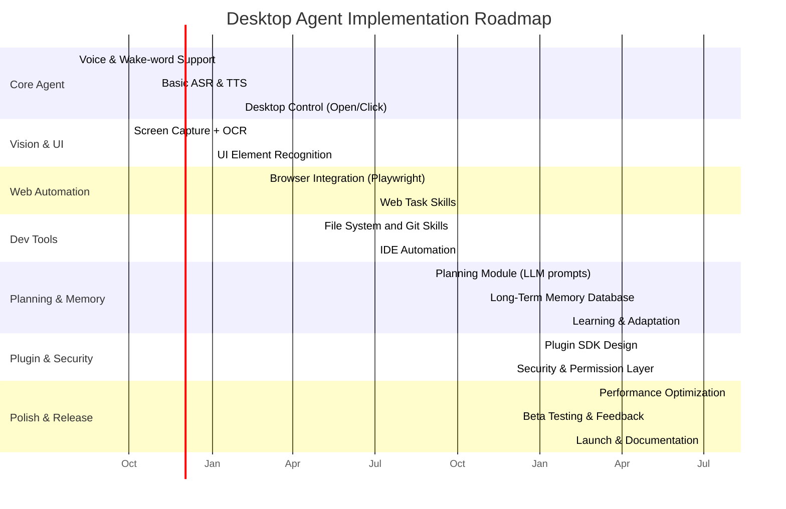
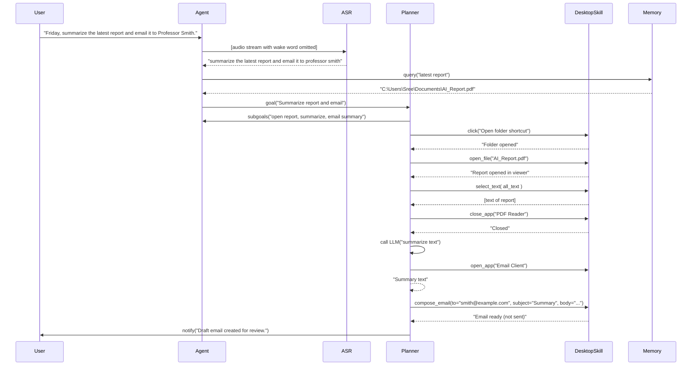

# Executive Summary  
Building a “FRIDAY”-style Windows desktop agent requires a **modular system of subsystems** – not just an LLM chatbot. Key functional requirements include robust voice interface (wake-word detection, ASR, VAD, TTS), continuous screen vision (UI element detection, OCR), **human-like control** of Windows (mouse/keyboard simulation, Windows APIs, PowerShell/COM), browser automation, file system and IDE/Git integration, long-term memory (databases or knowledge graph), a multi-step planner/agent module, security/permission handling, a plugin SDK, and logging/telemetry. Nonfunctional needs emphasize low latency (sub-300ms for voice loops), strict privacy (local/offline operation), efficient resource use, high reliability (fail-safes and recovery), and a secure permission model (user prompts for sensitive actions).  

We survey **free/open-source options** for each subsystem: for voice – *openWakeWord*, *Silero VAD*, *Vosk* or *Whisper/Faster-Whisper* for ASR, and models like *Kokoro*, *Piper*, or *eSpeak NG* for TTS; for vision – UI-Automation libraries (e.g. **pywinauto**), OCR engines (e.g. Tesseract or DeepSeek-OCR), and vision-language models (e.g. BLIP2) to interpret screen content; for control – Windows UI Automation (Win32/UIA) via Python or C#, automation frameworks (Selenium or Playwright for browsers); for memory – SQLite or vector databases (Faiss, Qdrant, Milvus) for embeddings; for planning – agent frameworks or custom loop (goal→planner→executors→verifier). We compare options in tables by license, offline capability, compute needs, and integration complexity.  

An **efficient architecture** will separate perception (voice/vision), reasoning (LLM/brain with planner), and skills (automation modules). Python is ideal for orchestration and rich libraries, Rust/C++ for performance-critical parts (vision, inference backends, DB), and C#/.NET for deep Windows integration (UI Automation, system calls). We recommend a **pipeline** where audio is wake-word-triggered, then passed to ASR+intent LLM, whose output is consumed by a planner that dispatches tasks to skills (desktop/browser control, file I/O, etc.), with a verifier ensuring success.  

A staged **implementation roadmap** spans ~2–3 years (30–40 person-months): 
1. **Core Agent (6–8 PM):** Voice I/O, simple LLM loop, UI Automation basics, file/terminal control. (MVP: wake-word → basic ASR → simple desktop commands).  
2. **Vision & UI Perception (4–6 PM):** Continuous screen capture, OCR (Tesseract/DeepOCR), UI element detection (UIA), vision-language reasoning.  
3. **Browser/Internet Skills (5–7 PM):** Integrate Playwright/Selenium, DOM-based or vision-based web automation (forms, browsing).  
4. **Developer Tools (4–6 PM):** IDE integration (VSCode via CLI), Git workflows automation.  
5. **Planner & Agent (6–8 PM):** Complex task planning, multi-step goals, retries, user feedback loop.  
6. **Learning & Memory (4–6 PM):** Habit learning (desktop layout, preferences), long-term memory (SQLite + vector DB), user profile graph.  
7. **Plugin Ecosystem (3–5 PM):** SDK design, extensibility for new skills (home automation, etc.).  

Testing/QA should include unit and integration tests (using mocks for GUI, headless browser tests), and end-to-end scenarios (e.g. “download file → summarize → email it”). Throughout, **performance optimization** (model quantization, GPU vs CPU inference trade-offs) and security (sandboxing actions, permission prompts, data encryption) must be enforced. 

Below we detail each requirement category, list and compare open technologies, outline architecture and design patterns, and present the roadmap with diagrams. 

## Functional Requirements  

- **Voice Interface:**  Continuous microphone listening with a *wake-word* detector (e.g. openWakeWord or Mycroft Precise). After wake-word, **VAD** (e.g. *Silero VAD*) should trim silence. Then **ASR** transcribes speech to text (e.g. *Vosk* or *OpenAI Whisper* via *faster-whisper*). For output, an expressive **TTS** engine (e.g. *Kokoro*, *Piper*, or *eSpeak*) speaks responses. End-to-end latency should stay under ~300ms for snappy conversation. Continuous listening implies a *streaming pipeline* with voice buffering and endpoint detection. 

- **Vision & UI Understanding:** The agent must **see the screen continuously**. Using Windows UI Automation (UIA) or Win32 APIs, it can detect active windows, controls, and textual elements. For arbitrary content (images, PDF, games), an OCR engine (e.g. *Tesseract*, *DeepSeek-OCR*) extracts text from screenshots. Computer-vision models (e.g. BLIP2, Qwen-VL for image captioning) can interpret complex GUI screenshots. The system should know window positions, sizes, and can map UI controls to semantic labels. E.g., to "click the ‘Submit’ button", the agent either finds it via UIA or uses image matching/OCR to locate it on screen. This requires frequent screenshots or a hook into the display buffer. 

- **Mouse & Keyboard Control:** The agent acts like a human user. It must send **mouse movements, clicks, drags, and keyboard input** to Windows. This can be done via OS APIs (SendInput/SetCursorPos in Win32), libraries (Python’s `pyautogui` or *pywinauto*), or .NET *UI Automation* calls. It must handle right-clicks, scrolls, shortcuts, and typing with pauses/human-like timing if needed. All tasks (opening programs, navigating menus, editing text, copying files) should use these simulated inputs or direct API calls (e.g. PowerShell for file ops).

- **Browser Automation:** The agent should perform web tasks (search, form-filling, downloads) safely. Options include using a headless browser library (Playwright or Selenium). For undetectable, real browsing, it can drive a visible browser instance and interact via the DOM or via vision. E.g., to “book a ticket,” it might navigate pages via Playwright, or use UI vision (e.g. *Ui.Vision RPA* which adds image-based automation). Key is supporting form entry, clicking links, handling logins/cookies, and verifying results.  

- **System Control (Windows APIs):** Complete OS control: installing/uninstalling apps, changing settings (volume, network), managing processes. This includes using Windows APIs, PowerShell scripts, and command-line tools. Examples: run `winget`, `DISM`, or PowerShell cmdlets for software management; call Win32 APIs to shutdown or restart; toggle Wi-Fi via WLAN API; adjust registry or environment settings. The agent needs admin privileges for sensitive actions (UAC elevation).  

- **File System and Development Tools:** Managing local files and projects: navigate folders, open, read/write/rename/delete files, zip/unzip, change wallpaper, etc. Use standard libraries (Python `os`, `pathlib`, or shell commands). For coding tasks: open IDE (VS Code), write/edit code, compile/build projects, run tests, and use Git (via command-line `git` or libgit2) to commit/push changes. The agent may scaffold projects or clone repos as needed.  

- **Long-Term Memory:** Persist user preferences, past interactions, and relevant data. E.g., remember user likes/dislikes, project deadlines, wifi passwords (securely), frequently accessed folders. Implement with a combination of **databases**: a SQLite or local JSON/CSV for structured data, and a vector database (Faiss, Qdrant) for embedding-based retrieval of notes/documents. Possibly maintain a knowledge graph linking entities (e.g. professors, courses). The memory should be queryable (“Where did I save that report?”) and updatable automatically.  

- **Planner / Task Manager:** Instead of one-shot answers, the agent must break complex goals into steps. This requires an internal **planner**: for example, on command “finish assignment and start game”, the agent plans sub-tasks (download slides, summarize notes, compile code, then launch game). A goal→plan→execute→verify loop (as in) ensures tasks complete before moving on. Patterns like HTN (Hierarchical Task Networks) or simply prompting an LLM to output a JSON task list can be used. A task manager should handle asynchronous tasks, track progress, retry failures, and possibly schedule future tasks (calendar integration).  

- **Security & Permissions:** Every destructive or sensitive action must require user approval. The agent runs with user privileges; for admin actions, it should invoke UAC or require the user to grant rights. It should validate commands to avoid dangerous side-effects (e.g. confirm before formatting, uninstalling, or emailing). A *permission manager* module logs permissions given, enforces least privilege, and prompts the user for each new type of action (file access, microphone, network, etc.).  

- **Plugin SDK & Extensibility:** The system should be modular so developers can add new “skills” without rewriting the core. Provide an SDK or API (e.g. Python interface or language-agnostic plugin protocol) to register new commands. Plugins run in sandboxes and report capabilities. E.g. a home automation plugin could allow “turn on lights” commands.  

- **Telemetry & Logging:** For diagnostics (but respecting privacy), log all actions, errors, voice transcripts, decisions and API calls. Use a configurable logger, with options to disable or encrypt logs. Telemetry (usage stats, crash reports) should be opt-in and anonymized to improve the agent (but not leak personal data).  

## Nonfunctional Requirements  

- **Low Latency:** The end-to-end loop (wake-word → ASR → LLM → TTS) should feel instant. Industry guidance suggests ~300ms end-to-end for voice assistants. This implies each component must be optimized: e.g. ASR RTF (real-time factor) <0.2, LLM sub-second inference, and fast TTS. Use streaming or incremental processing (VAD to skip silence, chunked LLM responses).

- **Offline/Local-First:** All core functionality must work without internet. Models and data are stored locally. No user speech or data is sent to cloud services by default (unless explicitly opted-in). This requires lightweight models or dedicated hardware. It also means using local TTS voices or small language models (e.g. open LLaMA variants) instead of calling GPT-5-cloud.  

- **Privacy:** By being local-first, audio and personal data never leave the PC, addressing privacy laws. Ensure that any persistent memory or logs are stored securely (encrypted on disk, user-protected). No API keys or accounts should be hard-coded.  

- **Resource Usage:** The agent should run continuously without overloading the machine. Use models sized to available hardware (GPU if present, else prefer quantized CPU models). Use C/C++ or Rust for intensive loops (vision analysis) and Python only where convenient. Idle CPU/GPU use should be minimal; for example, only run expensive vision analysis when the user is likely present or as needed.  

- **Reliability:** The system must gracefully handle errors (e.g. OCR failure, model OOM) by retrying or informing the user, not crashing. Include watchdogs, circuit-breakers (if a model API fails multiple times, switch strategy). Also design a fallback plan (e.g. text input mode if speech fails).  

- **Fail-safes:** Before any critical action (system settings change, file delete, network post), ask user confirmation. The agent should also allow an “abort” voice command at any time (interrupt the current plan). Keeping a safety “cancel” voice keyword is recommended.

- **Security Model:** Run as a normal user process, not as SYSTEM. Use Windows security features (AppContainer, virtualization) to sandbox untrusted plugins. Sign and authenticate code to prevent tampering. Maintain a whitelist of safe operations, and treat unknown commands carefully (possibly refuse them).  

- **Permission Prompts:** For new capabilities (like deleting files, accessing email, installing software), prompt the user with a clear description (“Agent wants to uninstall Discord.exe; approve or deny?”). Log approvals with timestamps. Optionally require password for highly sensitive actions.  

## Free/Open-Source Technologies & Libraries  

### Voice & Audio Subsystems  
- **Wake-word detection:** *openWakeWord* (Apache-2.0) – Python library with pre-trained models, low-latency. *Mycroft Precise* (Apache 2.0) – another open keyword listener. Both run offline, require CPU support for audio frames.  
- **VAD (Voice Activity Detection):** *Silero VAD* (open-source PyTorch, licensed MIT) – efficient on CPU. *webrtcvad* (MIT) – C module for basic VAD (monophonic, less accurate in noise). Silero yields better accuracy/noise robustness.  
- **ASR (Speech-to-Text):**  
  - *Vosk* (Apache 2.0) – works offline, lightweight (~50MB models for English), supports streaming and many languages, bindings for Python/C#/Java. CPU-friendly (runs on Raspberry Pi). Latency is low and realtime factor <1 on modern CPUs.  
  - *OpenAI Whisper* (MIT) – high accuracy (translates too), but large (small model ~300MB, large ~6GB). *Faster Whisper* (MIT) – optimized C++ version for Whisper with accelerated inference (CTranslate2 backend) for real-time on GPU/CPU. Whisper’s accuracy is high, but on CPU it is slow (optimally requires GPU or quantized models).  
  - *Wav2Vec2* (Apache 2.0 via HuggingFace) – self-supervised model, needs fine-tuning for best accuracy. Can run on CPU if small variant; streaming not native.  
  - *Silero STT* – open models in PyTorch (Apache-like), but may need GPU for best speed/accuracy.  
- **TTS (Text-to-Speech):**  
  - *Kokoro* (Apache 2.0) – compact (82M), real-time on CPU, high quality, English/Chinese voices.  
  - *VITS-based models* (Apache 2.0, e.g. Vits+NeMo) – many variants available (e.g. coqui-ai TTS) for expressive voices. Requires GPU for speed or CPU for slower but usable output.  
  - *Piper* (Apache 2.0) – efficient, multi-language neural TTS (e.g. released by Rhasspy). Runs on CPU.  
  - *eSpeak NG* (GPL) / *Pico TTS* (LGPL) – very lightweight, low-fidelity but real-time on any CPU. Use as fallback for short feedback.  
  - *FishAudio S2 Pro* (license unclear) or others – advanced, but heavy (listening possibility if Apache).  

### Vision & UI Understanding  
- **Screen capture & processing:** Use Win32 APIs to grab screenshots (e.g. `BitBlt` or DXGI duplication). For analysis:  
  - *OCR:* Tesseract (Apache 2.0) – classic OCR (CPU-only, medium accuracy). *DeepSeek-OCR* or *EasyOCR* (Apache 2.0) – neural OCR with higher accuracy (requires GPU for speed, ~0.3s per frame on CPU). Vision-language *Foundation models* like BLIP2 (Apache/MIT) can describe screenshots (heavy, needs GPU).  
  - *UI Element Info:* *pywinauto* (BSD-3-Clause) – Python library using Win32/UIA to read control text and structure. Also *WinAppDriver* (MIT) or .NET UIAutomation libraries can be used. This covers “inspectable” UI elements (menus, dialogs) directly.  
  - *Computer Vision:* To detect windows/buttons not exposed via UIA, use *OpenCV* (BSD) for template matching or *detectron2* (Apache 2.0) trained on GUI elements. YOLOv5/v8 (GPLv3) can detect icons or UI patterns, though license is copyleft.  
  - *Semantic Understanding:* Vision-language models (e.g. *Qwen-VL* if available open, or *MiniGPT-4* style) to interpret screenshots, or simpler: OCR + text embedding (OpenAI CLIP or CLIP-like ViT models under MIT/Apache) to classify UI type (e.g. “this is YouTube login page”).  
- **UI Automation:** *pywinauto* (BSD-3) for automating Win32/UIA controls, *AutoHotkey* (GPL) for scripting keystrokes, or .NET’s System.Windows.Automation (MIT license). Choose per need (pywinauto for Python ease; C# UIA for deep integration).  

### Desktop & Browser Automation  
- **Windows Control:** Use *Windows UI Automation (UIA)* API via C# or Python (pywinauto or uiautomation package). Direct Win32 calls (`SendInput`, `ShellExecute`, *PowerShell* scripts) for system tasks. *pyautogui* or *autoit* (Creative Commons) for generic input automation.  
- **Browser Control:** *Playwright* (MIT) – supports Chromium/Firefox/Edge on Windows, can run headful or headless and script page interactions. *Selenium* (Apache 2.0) – older but mature, supports multiple browsers. *Puppeteer* (MIT) – Node.js only, can be used via a subprocess or bridging.  
- **RPA Tools:** *Ui.Vision RPA* (AGPL) – browser extension + desktop macros with OCR vision. *Robot Framework* (Apache 2.0) – general automation test framework, can control Windows apps.  

### Memory & Storage  
- **Databases:** *SQLite* (public domain) for structured data (user profile, settings). *Redis* (BSD) optionally for quick data.  
- **Vector DB for embeddings:** *Faiss* (Apache 2.0) – C++ library for nearest-neighbor search (usable in Python); *HNSWLib* (MIT) – C++ ANN graph library; *Milvus* (Apache 2.0) – standalone vector DB with REST/gRPC, supports GPU indexing; *Qdrant* (Apache 2.0) – Rust-based vector DB with easy Python client. *Weaviate* (Apache 2.0) – vector DB with GraphQL. For lightweight offline, Faiss/HNSWlib integrate directly; Qdrant/Milvus require running a service but offer persistence.  
- **Knowledge Graph:** *RDFLib* (BSD) for semantic triples. *NetworkX* (BSD) for graph data. But a full KG engine is heavy; likely implement custom linking (e.g. mention-relations in SQLite).  

### Planning & Orchestration  
- **Agent Frameworks:** While no turnkey open local assistant exists, we can use patterns. *LangChain* (MIT) provides an agent/chain abstraction (but is Python code, can run with local LLMs). *ReAct agents* style prompting. For formal planning: *pyperplan* (Apache) for classical planning, though writing PDDL is complex. Better to implement a custom JSON-based task flow.  

### Security & Deployment  
- **Sandboxing:** Use Windows sandbox (available on Pro/Enterprise) or containerization (WSL with X server? But then UI control is complex). Possibly use *AppContainer* tokens for untrusted plugins.  
- **Encryption:** *openssl/libssl* (Apache) or Windows DPAPI for encrypting stored memory.  
- **CI/CD & Packaging:** Use *PyInstaller* or *cx_Freeze* (both MIT) to bundle Python components. Or develop core in .NET and distribute as MSI/EXE. *Inno Setup* (BSD) for installer, or *WiX Toolset* (WPF) for Windows. Auto-update: leverage GitHub Releases or tools like *Squirrel.Windows* (MIT).  

The table below summarizes key candidate tools/models for various subsystems:

**Table: Candidate Tools/Models** 

| Name                   | Category          | License       | Offline? | GPU/CPU Needs        | Accuracy/Quality     | Integration        | Source/Docs                         |
|------------------------|-------------------|---------------|----------|----------------------|----------------------|--------------------|-------------------------------------|
| **openWakeWord**        | Wake-word        | Apache 2.0    | Yes      | CPU (light)           | High for short phrases  | Python API         | [GitHub](https://github.com/dscripka/openWakeWord) |
| Mycroft **Precise**    | Wake-word        | Apache 2.0    | Yes      | CPU (light)           | Good (customizable)  | Python            | [GitHub](https://github.com/MycroftAI/mycroft-precise) |
| **Silero VAD**         | VAD             | MIT           | Yes      | CPU (fast inference)  | Good (low false positives) | Python           | [GitHub](https://github.com/snakers4/silero-vad)    |
| **Vosk**               | ASR             | Apache 2.0    | Yes      | CPU (efficient)       | Moderate (WER ~5–10%) | Multi-bindings     | [Docs](https://alphacephei.com/vosk/)                |
| Whisper (OpenAI)       | ASR/STT         | MIT           | Yes      | GPU recommended (CPU slow) | Very high (99+ langs, ~<5% WER) | PyTorch or C++   | [GitHub](https://github.com/openai/whisper)        |
| *faster-whisper*      | ASR (Whisper optimized) | MIT   | Yes      | GPU/CPU (multithreaded) | Similar to Whisper   | Python/C++        | [GitHub](https://github.com/guillaumekln/faster-whisper) |
| Wav2Vec2 (HuggingFace) | ASR (Transformer) | Apache 2.0  | Yes      | GPU/CPU (slower)      | Good (requires fine-tuning) | Transformers API | [HF Models](https://huggingface.co/models?pipeline_tag=automatic-speech-recognition) |
| **Kokoro**           | TTS             | Apache 2.0    | Yes      | CPU (very fast)       | Very natural        | Python (TTS libs)  | [HuggingFace](https://huggingface.co/jester/Kokoro-82M) |
| eSpeak NG               | TTS             | GPL 3.0       | Yes      | CPU (very light)      | Robotic (fair clarity) | Python bindings    | [GitHub](https://github.com/espeak-ng/espeak-ng)    |
| **Piper TTS**          | TTS             | MIT           | Yes      | CPU (fast)            | Good, multilingual  | Python            | [GitHub](https://github.com/rhasspy/piper)         |
| Tesseract OCR          | OCR/vision      | Apache 2.0    | Yes      | CPU (moderate)        | Medium (depends on font) | Command-line/API | [GitHub](https://github.com/tesseract-ocr/tesseract) |
| EasyOCR                | OCR (NN)       | Apache 2.0    | Yes      | GPU (faster) or CPU   | High for text       | Python           | [GitHub](https://github.com/JaidedAI/EasyOCR)      |
| OpenCV                 | CV Toolkit      | BSD 3-Clause  | Yes      | CPU (and GPU)         | N/A (tools)         | C++/Python        | [Site](https://opencv.org/)                          |
| pywinauto        | UI Automation  | BSD 3-Clause  | Yes      | CPU (light)           | N/A (works on Win UIA) | Python          | [GitHub](https://github.com/pywinauto/pywinauto)    |
| WinAppDriver           | UI Automation  | MIT           | Yes      | CPU                   | N/A                | C#/Selenium style | [GitHub](https://github.com/microsoft/WinAppDriver) |
| Playwright             | Browser (UI)    | Apache 2.0    | Yes      | CPU/GPU (browser)     | N/A                | Multi-language   | [Site](https://playwright.dev/)                      |
| Selenium               | Browser (UI)    | Apache 2.0    | Yes      | CPU (browser)         | N/A                | Multi-language   | [Site](https://www.selenium.dev/)                    |
| **Faiss**              | Vector DB      | Apache 2.0    | Yes      | CPU (GPU optional)    | High (ANN)         | C++/Python        | [GitHub](https://github.com/facebookresearch/faiss)  |
| **Hnswlib**            | ANN Search      | MIT           | Yes      | CPU                   | High (ANN)         | C++/Python        | [GitHub](https://github.com/nmslib/hnswlib)         |
| **Milvus**            | Vector DB      | Apache 2.0    | Yes      | CPU/GPU (docker)      | High (scale-out)   | REST/gRPC        | [Site](https://milvus.io/)                          |
| **Qdrant**            | Vector DB      | Apache 2.0    | Yes      | CPU                   | High (ANN, JSON)   | HTTP/REST        | [GitHub](https://github.com/qdrant/qdrant)          |
| Llama 2 (Meta)        | LLM (Plan/Chat) | Apache 2.0    | Yes      | GPU (8–80B) / CPU (small) | Very capable      | Transformers/LlamaCPP | [HuggingFace](https://huggingface.co/meta-llama) |
| Vicuna 13B (LLM)      | LLM (Chat)      | Apache 2.0    | Yes      | GPU/CPU (quantizable) | Good (chatty)      | PyTorch          | [HuggingFace](https://huggingface.co/lmsys/vicuna-13b) |
| Mistral 7B            | LLM (Chat)      | Apache 2.0    | Yes      | GPU/CPU (small mem)   | High (SOTA small)  | Transformers     | [HuggingFace](https://huggingface.co/mistralai/Mistral-7B-v0.1) |
| Ollama (client)       | LLM infer (multimodal) | Apache 2.0 | Yes | CPU/GPU           | Wrap local models  | API             | [Ollama](https://ollama.com/)                        |

*(Offline: whether the model/tool runs locally without cloud. GPU/CPU: typical hardware used.)*

For each item, licenses are open-source-friendly, and all can be run on local hardware (some need GPU for speed but fall back to CPU). Integration ranges from easy (pip installs) to moderate (running vector DB servers). Primary sources are linked.

## Architectures & Design Patterns  

A **modular agent architecture** is essential. We recommend a **layered pipeline** (Fig. below):

```mermaid
flowchart LR
    A[Wake Word (Voice)] --> B[ASR & VAD] --> C[LLM "Brain"] --> D[Planner/Task Manager]
    D -->|selects| E[Skills/Execution Modules]
    subgraph Skills
        F[Desktop Controller]\n(Win32/UIA, PyAutoGUI) --> G[Windows API/Powershell]
        H[Browser Controller] --> I[Playwright/Selenium]
        J[File Manager] --> K[OS/File API, Git]
    end
    D --> L[Memory Database]
    L --> C
    E --> M[User (Prompt/Query)]
    D --> N[Verifier (Check & Feedback)]
    N --> D
```

- **Voice Layer (Wake-Word → ASR → LLM):** A continuous audio listener triggers on a keyword (e.g. “Friday”). Then streaming ASR (with VAD silences) produces text. This text is fed to the LLM/“brain”. (We put the conversation LLM at the “top” here as the reasoning core.)  
- **Planner & Task Manager:** The LLM may output an intermediate goal list or JSON plan. The Planner decides which *skill modules* to invoke in sequence. It monitors execution and retries if needed, similar to the `ComputerAgent` loop in the CUA SDK.  
- **Skills/Execution Modules:** These are specific to tasks: *Desktop Controller* (to operate Windows UI, open apps, click, type), *Browser Controller* (for web tasks), *File Manager* (managing files, Git operations), etc. Each uses relevant APIs: UIA or Win32 for desktop, Playwright for browser, Python file libraries for FS.  
- **Memory & Knowledge:** The Planner logs tasks/results into long-term memory (SQLite + vector DB). Context from memory feeds back into the LLM (for personalization).  
- **Verification:** After each action, a verifier (LLM or rule-checker) confirms success (e.g. by OCR or process check). If something went wrong, the planner can adapt.  

**Language Choice:** Use **Python** as the “glue” due to its rich AI libraries (PyTorch, pywinauto, Playwright). For heavy computation: **Rust/C++** modules can be used (e.g. for a high-speed screen OCR or a vector DB driver). **C#/.NET** is advisable for deep Windows integration (UI Automation, COM, Windows services). For example, building a background Windows service in C# with embedded Python could combine ease-of-use with native performance.  

**Modularity & Plugins:** Design around a **message-passing or plugin interface**. For instance, each skill could be a separate process or module exposing an API. The core dispatcher calls them via RPC or CLI. This allows sandboxing (e.g. run plugins as separate processes with limited permissions). A plugin SDK should specify how to register new commands (e.g. a JSON file listing “intent names” and corresponding executables).  

**Incremental Learning/Adaptation:** Continuously update user models. For example, track the user’s desktop habits or coding style. Use **observation modules**: a Vision tracker notices window rearrangements and offers to automate them (as in the example “prepare workspace”). For coding style, the agent could store code snippets and style rules. This could be handled by the Memory/Knowledge subsystem, feeding preferences into the LLM via prompts.  

## Implementation Roadmap & Milestones  

**Milestones (with rough effort):**  
1. **Core OS Agent** (6–8 PM): Build voice I/O (wake-word, ASR, basic TTS), simple LLM loop, and a few Windows controls (open app, type, click). Test basic command execution. *MVP:* “Open Notepad and type X.”  
2. **Vision/Context Module** (4–6 PM): Add continuous screen capture, OCR (Tesseract), and UI element reading (pywinauto inspector). Allow commands like “What’s on screen?” or “Click the button that says Continue.”  
3. **Browser Automation** (5–7 PM): Integrate Playwright for web tasks (logging in, form filling). *MVP:* “Search Google and open first result.” (Note bot-detection issues; may need stealth).  
4. **Developer Mode** (4–6 PM): Add file and code skills: open VSCode, search in project, run Git. *MVP:* “Commit and push changes.”  
5. **Planner & Multi-Step Tasks** (6–8 PM): Implement a planning loop. Design prompt templates or planning algorithms for breaking down tasks and handling dependencies. *MVP:* “Plan a 3-step workflow and execute it.”  
6. **Memory & Personalization** (4–6 PM): Deploy a local DB, store key user data, integrate a vector DB for document search. *MVP:* “Recall last week’s assignment details.”  
7. **Plugin SDK & Ecosystem** (3–5 PM): Define a plugin interface, create sample plugin (e.g. “Weather” skill). *MVP:* “Enable plugin; ask custom command.”  

Total: ~32–40 person-months (for a small team; one developer would take years).  

**Testing/QA:** Unit tests for each module (e.g. simulate voice inputs, UI interactions). Use a headless mode for browser tests and CI jobs. Create integration tests simulating end-to-end scenarios (with recorded audio and screen environments). Implement logging at each step to trace failures.  

Below is a sample **timeline (Gantt)** for a 24-month project:



*Legend:* **PM = person-month.**  

## Security, Privacy & Safety Checklist  

- **Data Privacy:** All data (voice, docs, logs) stored locally and encrypted at rest. No automatic external calls without explicit permission.  
- **User Consent:** Always prompt/confirm before any sensitive action. Maintain an audit log of approvals. Include an easy “undo” or “abort” voice command.  
- **Least Privilege:** The agent’s processes run under user context, not as admin. Elevate privileges only momentarily when needed (with UAC).  
- **Model Safety:** Use LLM “guardrails” to prevent unsafe outputs (e.g. not suggesting illegal actions). Optionally integrate a content filter (open-source tools exist) for disallowed content.  
- **Fail-Stop:** On system errors or timeouts, safely halt and roll back partial changes where possible. Keep a snapshot of critical state before large operations.  
- **Logging:** Securely log all actions, but scrub sensitive content (e.g. redact passwords). Allow easy opt-out of telemetry.  
- **Authentication:** For commands accessing accounts (email, calendar), use OAuth or secure local tokens. Protect any API keys or credentials.  

Implementing these defaults ensures the agent is **helpful yet safe** by design.  

## Performance Optimization & Model Choices  

- **Quantization & Distillation:** For LLMs, use 8-bit or 4-bit quantization (with libraries like GPTQ or llama.cpp) to speed up inference at small accuracy cost. E.g., *whisper.cpp* used 5-bit quantization with minimal quality loss. TTS models like Kokoro can be run in FP16 or int8. For vector DBs, use approximate algorithms (HNSW) and vector quantization to save memory.  
- **Batching & Caching:** If multiple queries come fast (speech frames, API calls), batch them (e.g. multi-sample inference). Cache frequent operations (like web logins).  
- **GPU/CPU Trade-offs:** Use GPU for LLMs and vision if available. Otherwise, choose smaller models (7B vs 70B LLM) or CPU-optimized ones (NVIDIA’s NeMo offers CPU-optimized ASR models). For ASR in particular, smaller Wav2Vec or Vosk can run real-time on CPU, while Whisper needs GPU unless heavily quantized.  
- **Streaming:** Process audio and video in streams (frame-by-frame for VAD/OCR) to avoid long latencies.  
- **Model Candidates:**   
  - *ASR:* Vosk (light CPU), Faster-Whisper (GPU/CPU), Silero STT.  
  - *LLM:* Llama2 (7B, 13B), Vicuna, or Meta’s *Phi-3* (if released, hypothetical). Multi-modal: LLaVA or Qwen-VL (if open).  
  - *Vision:* CLIP or OpenCLIP (MIT) for image-text matching; YOLOv8 (GPL) for GUI object detection; Tesseract or OCR-Vision models for text.  
  - *TTS:* Kokoro (Apache) for real-time, Coqui-TTS models for variety, or lightweight LPCNet-based voices (open).  

Each model choice is linked to source code or official repo in the table above. Performance must be profiled per hardware; aggressive quantization (like *whisper.cpp*’s 5-bit) can yield real-time even on CPUs.

## Developer Tooling & Packaging  

- **Language & Frameworks:** Core logic in Python (rich ML libs), CI/CD in GitHub Actions or Azure DevOps. Use Docker for building environment consistency.  
- **Testing:** PyTest or Unittest for unit tests; custom integration tests for voice and UI (recorded sessions). Simulated user input can automate GUI tests (e.g. OpenAI Gym style, or use AutoHotkey scripts).  
- **Packaging:** Use PyInstaller (MIT) to create a single `Friday.exe` bundling Python code and models. Or compile C#/C++ components and package with an installer like Inno Setup. Include an auto-update mechanism (pull from GitHub releases, verify signature).  
- **Plugin SDK:** Define a protocol (e.g. JSON RPC over stdin/stdout). Provide a sample plugin template (in Python or C#) and documentation. The agent should discover plugins from a folder and list available commands.  

## Example Sequence  



This sequence (simplified) shows how voice input triggers ASR, how the agent queries memory, breaks the task into subgoals, uses desktop skills to open files and read text, uses the LLM to summarize, then composes an email with the result. Each step checks for completion before proceeding.

## References  

- **Voice Processing:** openWakeWord (wake-word detection); Vosk ASR toolkit; Silero VAD for CPU-based voice activity detection.  
- **Vision/Automation:** pywinauto (Windows GUI automation); Local Whisper optimization (silence removal with VAD).  
- **Agent Architecture:** Example vision-based agent and CUA SDK (Computer-Using Agent loop).  
- **Latency Requirements:** Industry guide on voice agent latency (recommend ~300ms total).  

All above sources illustrate key design choices for a local, multimodal Windows agent. The final system architecture and tech stack are guided by these references and by open-source project documentation.