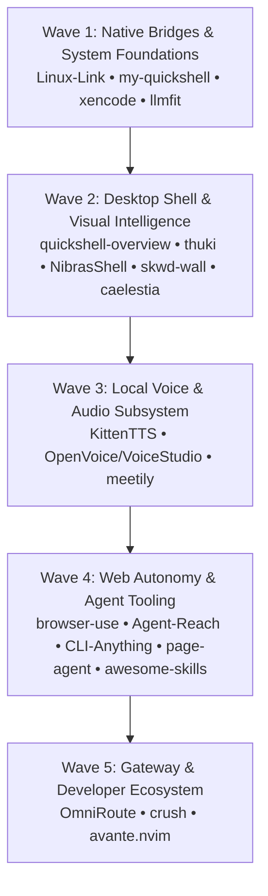

# Ecosystem backlog (parked)

> Parked on 2026-11-04. This was the 20-capability, 5-wave roadmap in
> `AGENTS.md`. It is kept for reference, not as the plan: see "Current plan"
> in `AGENTS.md`. Pull an item from here only once the first-hour
> experience is solid and the item serves the core use case.

Project FRIDAY incorporates 20 high-value capabilities curated from starred repositories into a unified 5-wave implementation roadmap:

### Wave 1 — Native Bridges & Hardware Adaptation
- **`sreevarshan-xenoz/Linux-Link`**: Remote desktop and phone pairing over Tailscale (Wayland streaming, clipboard sync, remote input).
- **`sreevarshan-xenoz/my-quickshell-config`**: Integration of the user's custom Quickshell QML shell and UPGRADE_ROADMAP modules.
- **`sreevarshan-xenoz/xencode`**: Local offline-first agentic coding companion integrated into the terminal/daemon.
- **`AlexsJones/llmfit`**: First-boot hardware profiler that evaluates CPU/GPU/VRAM to auto-configure optimal Ollama models.

### Wave 2 — Wayland Desktop Shell & Visual Intelligence
- **`Shanu-Kumawat/quickshell-overview`**: Interactive drag-and-drop workspace overview for Hyprland.
- **`quiet-node/thuki`**: Lightweight context-aware floating AI companion widget for desktop tasks.
- **`AhmedSaadi0/NibrasShell`**: Native AI prompt and response UI widgets in Quickshell.
- **`liixini/skwd-wall`**: Aesthetics-first wallpaper and video background selector in Rust.
- **`caelestia-dots/shell`**: Alternative morphing shell option in the Friday installer.

### Wave 3 — Voice, Speech & Iron Man Persona
- **`KittenML/KittenTTS`**: Ultra-fast on-device TTS under 25MB for sub-second spoken replies.
- **`myshell-ai/OpenVoice` / `debpalash/VoiceStudio`**: Friday / Jarvis voice cloning and expressive speech profiles.
- **`Zackriya-Solutions/meetily`**: 100% local meeting notes, live Whisper transcription, and audio processing.

### Wave 4 — Autonomous Browser & Universal System Control
- **`browser-use/browser-use`**: Full browser automation agent for `friday goal` web tasks.
- **`Panniantong/Agent-Reach`**: Zero-cost internet search and article scraping for agent awareness.
- **`HKUDS/CLI-Anything`**: Universal translation layer making any installed Linux CLI agent-native.
- **`alibaba/page-agent`**: Natural language DOM operator for GUI web pages.
- **`sickn33/agentic-awesome-skills`**: Pre-built skill catalog integration into `friday-skill-forge`.

### Wave 5 — Gateway & Developer Power Tools
- **`diegosouzapw/OmniRoute`**: Local-first multi-model AI gateway with token compression.
- **`charmbracelet/crush`**: Beautiful terminal agent for interactive coding.
- **`avante-corp/avante.nvim`**: Cursor AI-like Neovim configuration pre-bundled in default skeleton.

---
